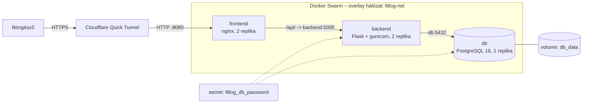

# Edzésnapló – többkonténeres webalkalmazás Docker Swarmon

Felhőszámítás kurzus – Docker Swarm projektfeladat.

**Nyilvános URL (bemutató alatt él):** `https://<ide-kerül-a-trycloudflare-link>.trycloudflare.com`
**Repository:** `https://github.com/<felhasznalo>/<repo>`

## Az alkalmazás célja

Egyszerű fitnesz- és edzésnapló: a felhasználó rögzíti az edzéseit (dátum, gyakorlat, sorozat, ismétlés, súly, időtartam, megjegyzés), visszaolvassa és törölheti a bejegyzéseket, a felület pedig összesítést mutat (bejegyzések a legutóbbi 7 napban, összes terhelés, összes edzésidő, napi bontású oszlopok). A lábléc a kiszolgáló backend task azonosítóját is kiírja, így a terheléselosztás és a skálázás a böngészőben is látható.

## Architektúra



| Service | Image | Szerep | Replika | Publikált port |
|---|---|---|---|---|
| `frontend` | saját (`frontend/Dockerfile`, nginx 1.27.2) | felhasználói felület, `/api/` reverse proxy | 2 | 8080 → 80 |
| `backend` | saját (`backend/Dockerfile`, Python 3.12.7) | REST API, validáció, üzleti logika | 2 | nincs |
| `db` | `postgres:16.4-alpine` | tartós adattárolás | 1 | nincs |

A service-ek név alapján érik el egymást (`backend`, `db`) a Swarm beépített DNS-én keresztül. Kívülről csak a `frontend` 8080-as portja érhető el. Az adatbázis jelszava Docker secretből érkezik, a repositoryban nincs jelszó.

## Előfeltételek

- Docker Engine 24 vagy újabb (Linux, vagy Docker Desktop)
- Docker Hub vagy GitHub Container Registry (GHCR) fiók
- `cloudflared` a nyilvános eléréshez ([telepítés](https://developers.cloudflare.com/cloudflare-one/connections/connect-networks/downloads/))

## Build és push

```bash
export REGISTRY=docker.io/FELHASZNALONEV      # vagy: ghcr.io/felhasznalonev
export TAG=1.0.0

docker login                                  # GHCR esetén: docker login ghcr.io
docker build -t $REGISTRY/fitlog-backend:$TAG  backend/
docker build -t $REGISTRY/fitlog-frontend:$TAG frontend/
docker push $REGISTRY/fitlog-backend:$TAG
docker push $REGISTRY/fitlog-frontend:$TAG
```

> Apple Silicon (ARM) gépen, ha a Swarm x86 gépen fut: `docker buildx build --platform linux/amd64 --push -t ...`.
> A GHCR csomagok alapból privátak: állítsa publikusra, vagy használja a `--with-registry-auth` kapcsolót (lent már szerepel).

## Telepítés Swarmra

```bash
docker swarm init                             # több hálózati interfésznél: --advertise-addr <IP>
docker node ls

# adatbázis-jelszó titokként (véletlenszerű, nem kell ismerni)
openssl rand -hex 16 | tr -d '\n' | docker secret create fitlog_db_password -

# a REGISTRY és TAG változónak ugyanabban a shellben kell lennie (sudo esetén: sudo -E)
docker stack deploy -c stack.yml --with-registry-auth fitlog
docker stack services fitlog
docker stack ps fitlog
```

Az alkalmazás ezután a `http://localhost:8080` címen érhető el. Az első indításkor az adatbázis inicializálása pár másodpercet vesz igénybe; a backend újrapróbálkozik, amíg a `db` el nem érhető.

## Nyilvános elérés (Cloudflare Quick Tunnel)

```bash
cloudflared tunnel --url http://localhost:8080
```

A parancs kiír egy `https://….trycloudflare.com` címet. Ez az URL ideiglenes, és csak addig működik, amíg a gép és a tunnel fut. Ezt a címet kell beírni a beadásba és a fenti fejlécbe. Teszteljen mobilinternetről vagy másik hálózatról is.

## Tesztelés

Az automatizált változat a `scripts/tests.sh` (manager node-on): `./scripts/tests.sh [stack_név] [url]`. A kézi parancsok:

| Teszt | Parancsok | Elvárt eredmény |
|---|---|---|
| Funkcionális | a webes felületen új edzés mentése, majd oldalfrissítés | a bejegyzés megjelenik a naplóban |
| Skálázás | `docker service scale fitlog_backend=3` majd `docker service ls` | `fitlog_backend` 3/3 |
| Hibatűrés | `docker kill $(docker ps -q -f name=fitlog_backend \| head -n1)` majd `docker service ps fitlog_backend` | a Swarm új taskot indít, a régi `Failed` állapotú |
| Perzisztencia | `docker service update --force fitlog_db`, majd a napló újratöltése | az adatok megmaradtak (azonos node, `db_data` volume) |
| Külső elérés | a trycloudflare URL megnyitása böngészőből | a felület betölt, mentés és olvasás működik |

A terheléselosztás látványosan megfigyelhető: a lábléc „Kiszolgáló task” értéke oldalfrissítésenként váltakozhat a backend replikák között.

## Leállítás és takarítás

```bash
# 1. Állítsa le a tunnelt (Ctrl+C a cloudflared ablakban)
docker stack rm fitlog
docker volume rm fitlog_db_data               # csak ha az adatokra nincs szükség
docker secret rm fitlog_db_password
docker swarm leave --force                    # ha a Swarm már nem kell
```

## Biztonság

- Nincs jelszó vagy token a repositoryban; a DB jelszó Docker secret (`/run/secrets/db_password`).
- Csak a `frontend` van publikálva; a `backend` és a `db` kizárólag az overlay hálózaton belül érhető el.
- A backend nem root felhasználóval fut; a SQL-lekérdezések paraméterezettek; a felület a megjelenített szövegeket escape-eli.
- Csak tesztadatot használjon, és a bemutató után állítsa le a tunnelt, mert az alkalmazásban nincs bejelentkezés.

## Követelmények teljesítése

| Követelmény | Megvalósítás |
|---|---|
| ≥ 3 különböző service | `frontend`, `backend`, `db` |
| Saját Dockerfile és image, rögzített verziók | `backend/Dockerfile`, `frontend/Dockerfile`; `python:3.12.7-slim-bookworm`, `nginx:1.27.2-alpine`, `postgres:16.4-alpine` |
| Swarm stack, overlay hálózat, tartós volume | `stack.yml`: `fitlog-net` (overlay), `db_data` |
| Név alapú kommunikáció, csak a belépési pont publikált | `backend:5000`, `db:5432`; csak a `8080` |
| Állapotmentes service ≥ 2 replika, healthcheck, restart policy | `frontend` ×2, `backend` ×2; `healthcheck` és `restart_policy` minden service-nél |
| Titokkezelés | Docker secret |

## Ismert korlátozások

- Egyetlen Swarm-node esetén a hibatűrés task-szintű, node-szintű nem.
- Az adatbázis egy példányban fut, és a volume-ja a manager node-hoz kötött; nincs replikáció és nincs automatikus mentés.
- Nincs felhasználókezelés: a napló közös, a lista a legutóbbi 100 bejegyzést mutatja.
- A TryCloudflare URL ideiglenes, a futó gépen és tunnelen múlik.
- Az overlay hálózat forgalma alapból nem titkosított (több node esetén: `driver_opts: encrypted: "true"`).
